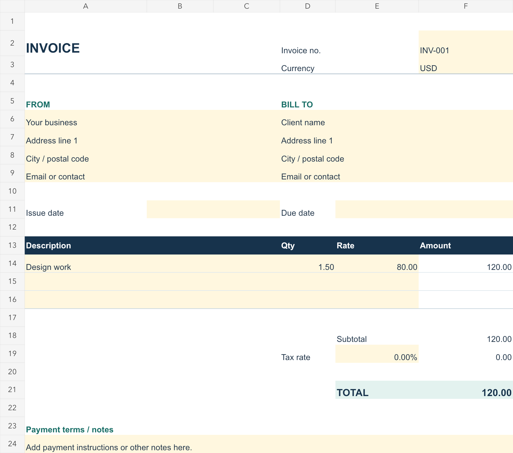

# Free three-line invoice spreadsheet

A small English-language invoice example for freelancers who want a local spreadsheet file. It has **three item rows**, one user-entered tax rate, and a notes area. The download is free and does not require an account.

[Download the free XLSX](https://github.com/yoonhyung1990/free-three-line-invoice/raw/refs/heads/main/Free-Three-Line-Invoice.xlsx)

## Optional paid file

I also sell a separately delivered [10-line invoice XLSX and English instructions](https://polisem.gumroad.com/l/offline-invoice-xlsx?utm_source=github&utm_medium=repo&utm_campaign=invoice_sample_20261028) for **$3 once, before any applicable tax**. The paid file uses the same general layout and calculations with 10 item rows rather than three. This free sample is usable without buying it. Other free templates and invoice tools are available, including [Zoho Invoice](https://www.zoho.com/invoice/pricing/) and [other free spreadsheet templates](https://github.com/invoicemaker/invoice-templates); compare the features before deciding.

## Use it

1. Download the XLSX and open it in a spreadsheet program. LibreOffice Calc is the program checked for this sample; Microsoft Excel and Google Sheets have not been individually verified.
2. Replace the pale yellow example fields with your details, invoice number, dates, line items, quantity and rate. Keep a separate copy for each invoice.
3. Enter the appropriate tax rate yourself. The example uses `1.5 × 80 = 120` and a zero tax rate. At 10%, the tax is 12 and the total is 132.
4. Review the result and the details your client and jurisdiction require before sending. In LibreOffice Calc, the example exported to one A4 PDF page. Your print settings and content length may change the result.

The sheet calculates line amounts, subtotal, one tax amount and total. It warns when a line has incomplete or invalid numeric inputs; it does **not** validate every business field or determine your tax obligations. It does not send invoices, collect payment, track history, convert currencies or provide tax or legal advice. A spreadsheet program is required separately.

The sample was created with AI assistance and checked using LibreOffice Calc and spreadsheet calculation tests. The sample may be used and edited for your own invoices. Use fictional data when testing.
